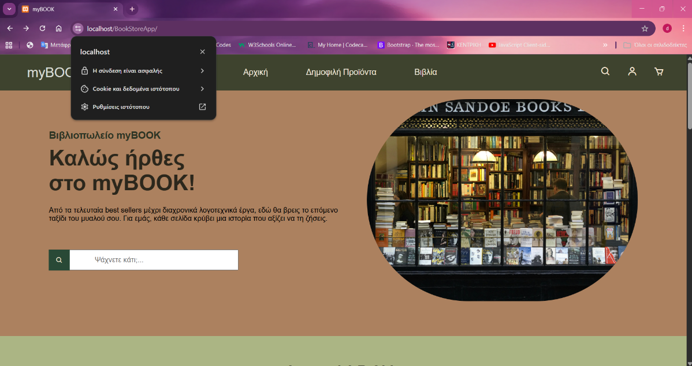
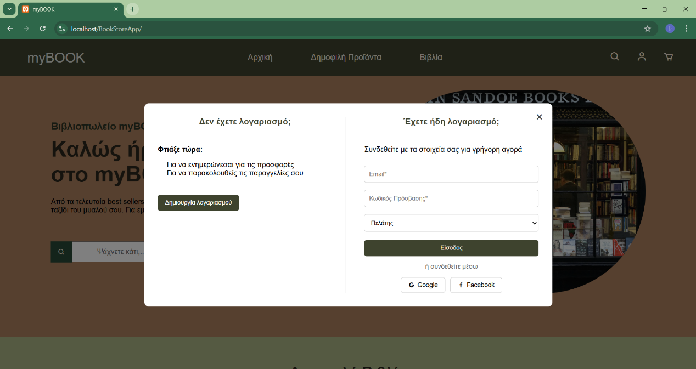
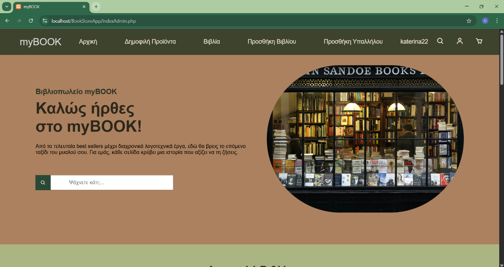
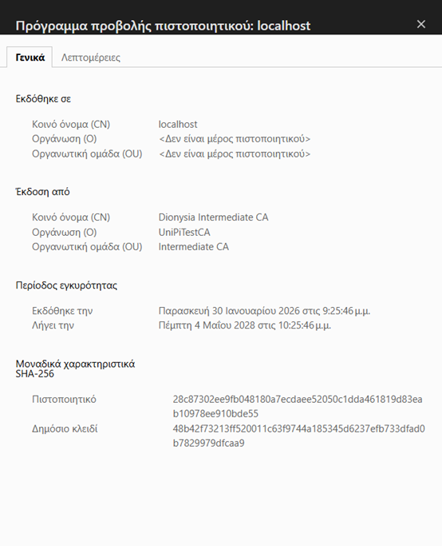
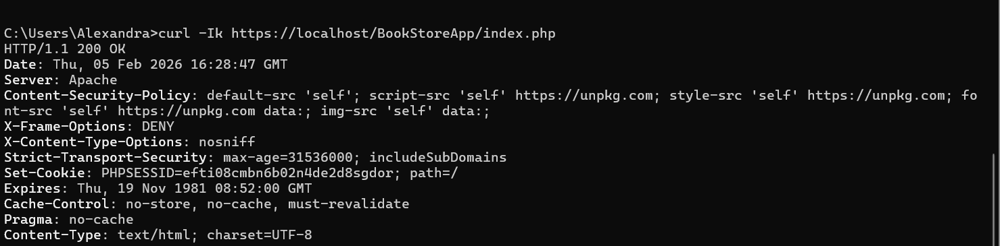

# MyBook — Secure Online Bookstore

> University team project · *Information Systems Security* · PHP · MySQL · Apache · TLS · OWASP ZAP

**MyBook** is an online bookstore web application built with a focus on **security**.
Customers browse and buy books, employees manage the catalogue, and admins manage
employee accounts. On top of the application itself, the project covers
**risk analysis, a security policy, HTTPS with a private certificate authority,
authentication and role-based access control, input validation, vulnerability
scanning with OWASP ZAP and CVSS-based re-assessment**.



<table>
  <tr>
    <td width="50%"></td>
    <td width="50%"></td>
  </tr>
  <tr>
    <td align="center">Login / sign-up</td>
    <td align="center">Admin view (add books, add employees)</td>
  </tr>
</table>

---

## Features

| Role         | Can do                                                                  |
|--------------|-------------------------------------------------------------------------|
| **Customer** | Browse and search the catalogue, view book details, manage a cart        |
| **Employee** | Everything a customer can, plus add new books to the catalogue           |
| **Admin**    | Everything an employee can, plus pre-register employees with a security code |

Employees cannot sign up freely: an admin first registers their e-mail together with a
**5-digit security code**, and only then can the employee complete their account.
Employees and admins must enter this security code at every login, as a second check
on top of the password.

---

## Security measures

### Application level
- **SQL injection:** every database query that uses user input is a **prepared statement** (MySQLi, parameter binding)
- **Password storage:** `password_hash()` / `password_verify()` (**bcrypt**)
- **XSS:** server-side input validation (`filter_input`, `FILTER_VALIDATE_EMAIL`, numeric whitelists) and output encoding with `htmlspecialchars()`
- **Authentication:** session-based, with **session ID regeneration** after login
- **Authorization:** **role-based access control (RBAC)** enforced on the server for every protected page and action
- **Second factor for staff:** security code required for employee and admin logins

### Server level (Apache / PHP)
- **HTTPS only:** HTTP is permanently redirected to HTTPS
- **Private PKI:** Root CA → Intermediate CA → server certificate (RSA 2048, SHA-256, with SAN for `localhost` / `127.0.0.1`), created with OpenSSL on Kali Linux
- **Security headers:** `Content-Security-Policy`, `Strict-Transport-Security`, `X-Frame-Options: DENY`, `X-Content-Type-Options: nosniff`
- **Information disclosure:** `ServerTokens Prod`, `ServerSignature Off`, `expose_php = Off`
- **Directory listing disabled** (`Options -Indexes`)

See [`docs/apache/security-config.conf`](docs/apache/security-config.conf) for the exact configuration.

<table>
  <tr>
    <td width="40%"></td>
    <td width="60%"></td>
  </tr>
  <tr>
    <td align="center">Server certificate issued by the private Intermediate CA</td>
    <td align="center">HTTP response headers after hardening</td>
  </tr>
</table>

### Security assessment
- **Risk analysis:** assets, impact assessment, threat assessment (unauthorized access, code injection, ransomware, web defacement, DoS) and risk ranking
- **Security policy** covering access control, data protection, availability, patch management and user awareness
- **OWASP ZAP** automated scan, then fixes for the findings (missing CSP, directory browsing, server version disclosure) and a re-scan to confirm them
- **CVSS v3.1 re-assessment** of known CVEs for PHP, MariaDB/MySQL and Apache (e.g. CVE-2023-3824, CVE-2023-3823, CVE-2023-43622, CVE-2023-38709)

---

## Post-submission security fixes

While preparing this repository I reviewed the code again and fixed some
**authorization flaws** in `login_register.php`:

| Issue                                                                                  | Fix |
|----------------------------------------------------------------------------------------|-----|
| The public sign-up form allowed anyone to register as **admin**                        | Only `customer` and pre-authorised `employee` registrations are accepted (role whitelist) |
| The *add employee* and *add book* actions did not check the user's role on the server  | Server-side checks added: admin only / admin or employee only (HTTP 403 otherwise) |
| At login, the user's role was stored in the session **before** the security code was checked, so the code could be bypassed | The security code is verified first, and the session is created only afterwards |
| No session ID regeneration after login (session fixation)                              | `session_regenerate_id(true)` after successful login / registration |
| Book rating (e.g. 4.5) was stored as an integer                                        | Bound as a decimal value |

**Possible next steps:** CSRF tokens on forms, `HttpOnly` / `Secure` / `SameSite` session
cookies, rate limiting for login attempts.

---

## Tech stack

- **Backend:** PHP 8.2 (MySQLi)
- **Database:** MySQL / MariaDB 10.4
- **Web server:** Apache 2.4 (XAMPP), mod_ssl, mod_headers, mod_rewrite
- **Frontend:** HTML, CSS, vanilla JavaScript
- **Security tooling:** OpenSSL (Kali Linux), OWASP ZAP, curl

## Project structure

```
mybook-secure-bookstore/
├── BookStoreApp/            # the PHP application (copy into xampp/htdocs)
│   ├── login_register.php   # authentication, registration, add employee / add book
│   ├── getBooks.php         # JSON API for the catalogue
│   ├── components/          # shared navbar
│   ├── scripts/  styles/  Images/
│   └── .htaccess
├── database/schema.sql      # tables + demo admin
└── docs/
    ├── apache/security-config.conf
    └── screenshots/
```

## Run locally (XAMPP)

1. Install [XAMPP](https://www.apachefriends.org/) and start **Apache** and **MySQL**.
2. Copy the `BookStoreApp` folder into `C:\xampp\htdocs\`.
3. Open **phpMyAdmin** → *Import* → choose `database/schema.sql`.
4. Open `http://localhost/BookStoreApp/`.

Demo admin (local development only):

| E-mail               | Password    | Security code |
|----------------------|-------------|---------------|
| `admin@mybook.local` | `Admin123!` | `12345`       |

Log in as admin to add books and register employees.
For HTTPS, generate your own certificates and use the settings in
[`docs/apache/security-config.conf`](docs/apache/security-config.conf).
Private keys and certificates are intentionally **not** included in this repository.

> The user interface is in Greek.

---

## Team

- **Alexandra Tourgoutoglou**: [GitHub](https://github.com/atourgoutoglou) · [LinkedIn](https://www.linkedin.com/in/alexandra-tourgoutoglou/)
- **Dionysia**

Developed for the *Information Systems Security* course, Department of Informatics, University of Piraeus.

*Book covers are used for demonstration purposes only and belong to their respective publishers.*
